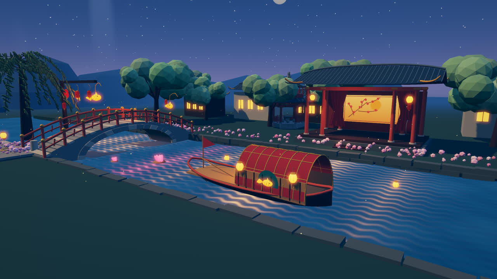

# 灯会河畔 · Lantern Riverside 3D

沿着河水看一场灯会。石拱桥、乌篷船、鱼灯和临河戏台，组成一个可以自由环视、漫游与跟随导览的 Three.js 场景。

An interactive lantern festival riverscape with orbit controls, first-person walking,
an animated river, and a guided camera tour. Built with Three.js and Vite.

**[打开在线体验 · Live demo](https://xiao-lu-liu.github.io/lantern-riverside-3d/)**



这是一次独立的 3D 场景探索，原型由 Kimi 生成，随后修复了鼠标操作、资源加载与部署路径。场景不是已经接入 Nookvale Puzzles 正式游戏的关卡。

## 游览方式

| 模式 | 操作 |
| --- | --- |
| 全景 | 按住左键拖动旋转，滚轮缩放，光标保持可见 |
| 漫游 | WASD 移动，按住左键拖动环视，Shift 加快移动 |
| 可选鼠标锁定 | 漫游中按 L 主动开启；Esc 恢复光标；切回全景也会释放 |
| 导览 | 自动串联河畔、船头、石桥与戏台，再次点击可暂停或继续 |
| 观景点 | 1 河畔全景、2 石拱桥头、3 临河戏台、4 乌篷船头 |
| 其他 | F 全屏、H 操作指南；右上角可保存留影、查看原画和游戏下载入口 |

手机界面提供移动摇杆和拖动环视。浏览器如果不允许锁定鼠标，可以继续使用默认拖动操作。

## 本地运行

建议安装 Node.js 24 LTS。项目需要支持 WebGL 2 的现代浏览器。

```sh
npm ci
npm run dev
```

打开终端显示的本地网址，默认是 `http://localhost:5173/`。

```sh
npm test
npm run build
npm run preview
```

`dist/` 是可部署的静态站点。通过 HTTP(S) 访问；直接双击 HTML 文件不能完整加载模型。

模型包约 50 MB，首次进入需要下载和解压。实际帧率取决于设备、浏览器和窗口大小。
渲染循环限制在约 60 次/秒，并在持续低帧率时降低画面倍率。

## GitHub Pages

本仓库使用 `.github/workflows/pages.yml`。每次推送到 `main`，GitHub Actions 会安装依赖、运行回归检查、构建并部署；拉取请求只运行检查和构建。

构建时会使用仓库名称设置项目路径，避免将模型请求发到域名根目录：

```sh
npm run build -- --base=/lantern-riverside-3d/
```

首次在自己的 Fork 中启用时，在 **Settings → Pages → Source** 选择 **GitHub Actions**，再手动运行该工作流。仓库名称可以改变，工作流会自动使用新名称作为部署路径。

参考：[Vite 的 GitHub Pages 部署说明](https://vite.dev/guide/static-deploy#github-pages)、[GitHub Pages 自定义工作流](https://docs.github.com/en/pages/getting-started-with-github-pages/using-custom-workflows-with-github-pages)。

## 浏览器验证与视频导出

先运行开发服务器，再在另一个终端执行：

```sh
npm run check:browser
```

默认使用已安装的 Chrome。也可以运行 `npx playwright install chromium`，并设置 `BROWSER_CHANNEL=chromium`。验证会覆盖鼠标、模式切换、模型加载、动画、留影及游戏下载入口。截图和结果保存在已忽略的 `.local-checks/`。

需要 FFmpeg 才能导出视频：

```sh
npm run export:video
```

默认生成前 20 秒导览，1920×1080、30 fps、无声 MP4，保存在已忽略的 `exports/`。这是从实际 3D 场景逐帧渲染的画面。

可设置 `SCENE_URL` 指定已有站点，使用 `VIDEO_START`、`VIDEO_SECONDS`、`VIDEO_WIDTH`、`VIDEO_HEIGHT`、`VIDEO_FPS` 和 `VIDEO_OUTPUT` 调整导出。网页和导出工具都没有内置配乐。

## 项目结构

```text
src/                 场景、建筑、植物、水面、后处理及操作逻辑
public/assets/       模型包及共用 gzip 解码器
tests/               鼠标操作和资源编码的回归检查
scripts/             浏览器验证与视频导出
.github/workflows/   自动构建和 Pages 部署
```

## 暖谷谜趣 · Nookvale Puzzles

HIKOO 的温馨找物解谜游戏：

- [App Store · iPhone / iPad](https://apps.apple.com/us/app/nookvale-puzzles/id6825582989)
- [Google Play · Android](https://play.google.com/store/apps/details?id=com.hikoo.zhaodongdong)

## 开源与素材说明

项目应用代码采用 [MIT 许可证](LICENSE)。第三方模型、贴图和展示图片不因本仓库的 MIT 许可证获得新的授权；来源及具体范围见 [THIRD_PARTY_NOTICES.md](THIRD_PARTY_NOTICES.md) 和 [CREDITS.md](CREDITS.md)。

欢迎通过 Issue 反馈浏览器、操作方式、具体症状和复现步骤，也欢迎提交改进。
